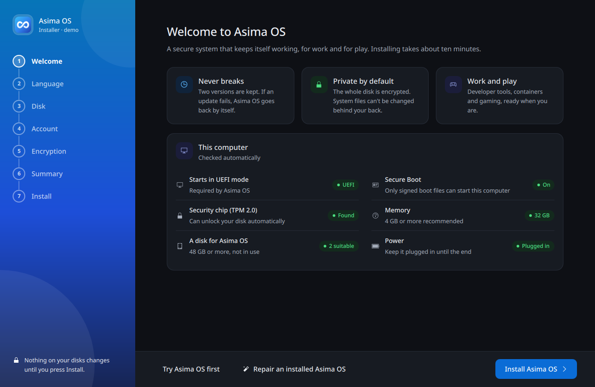
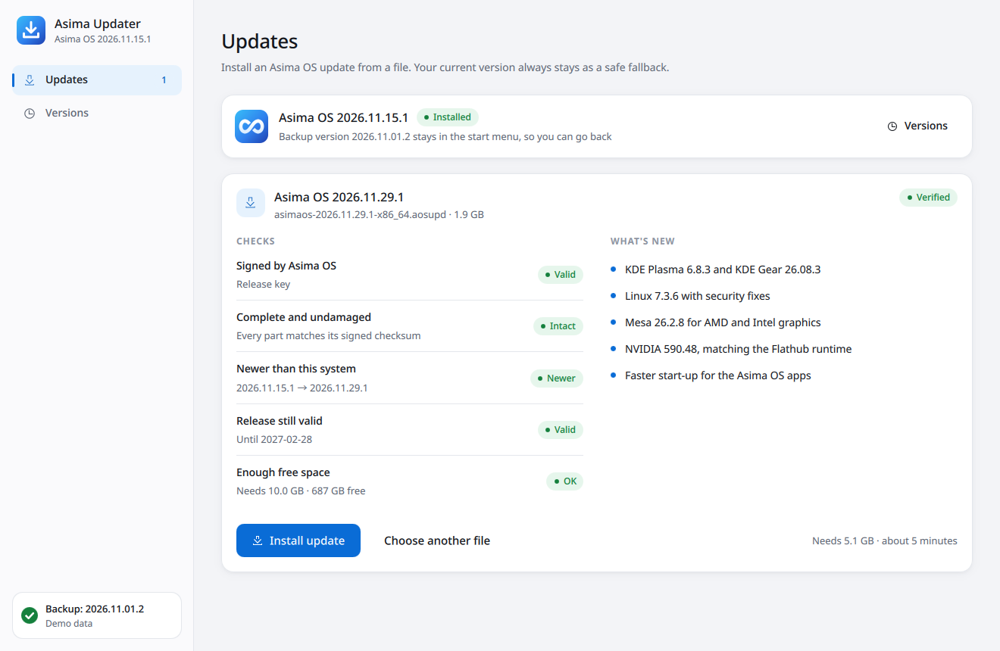
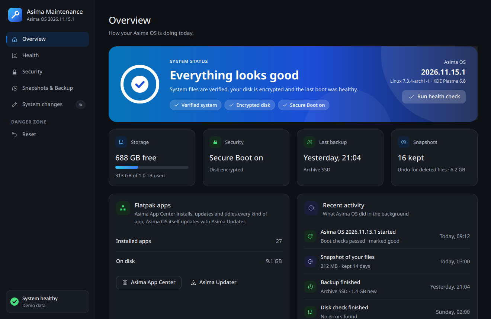
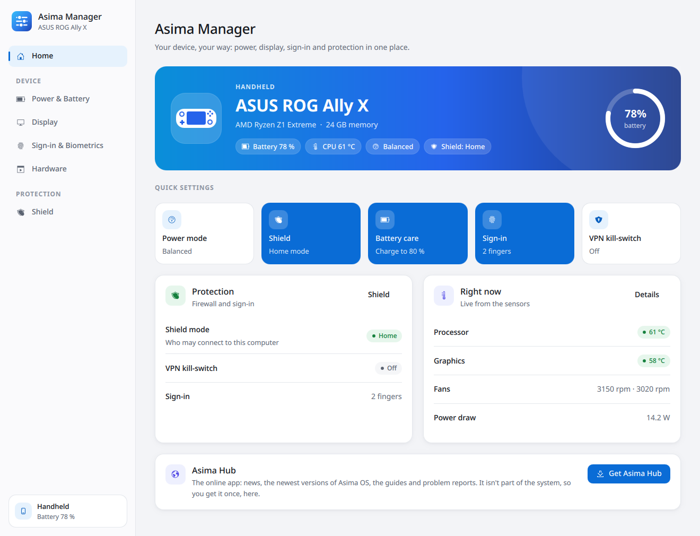
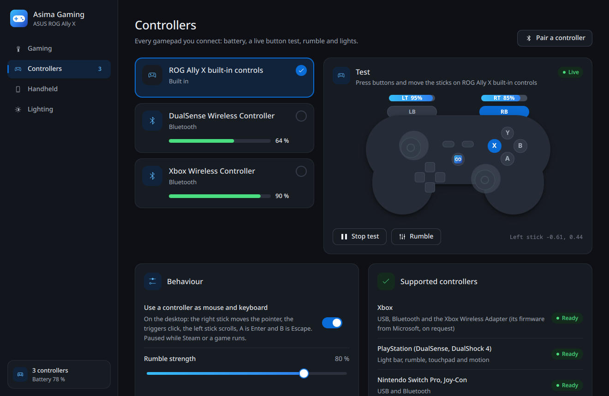
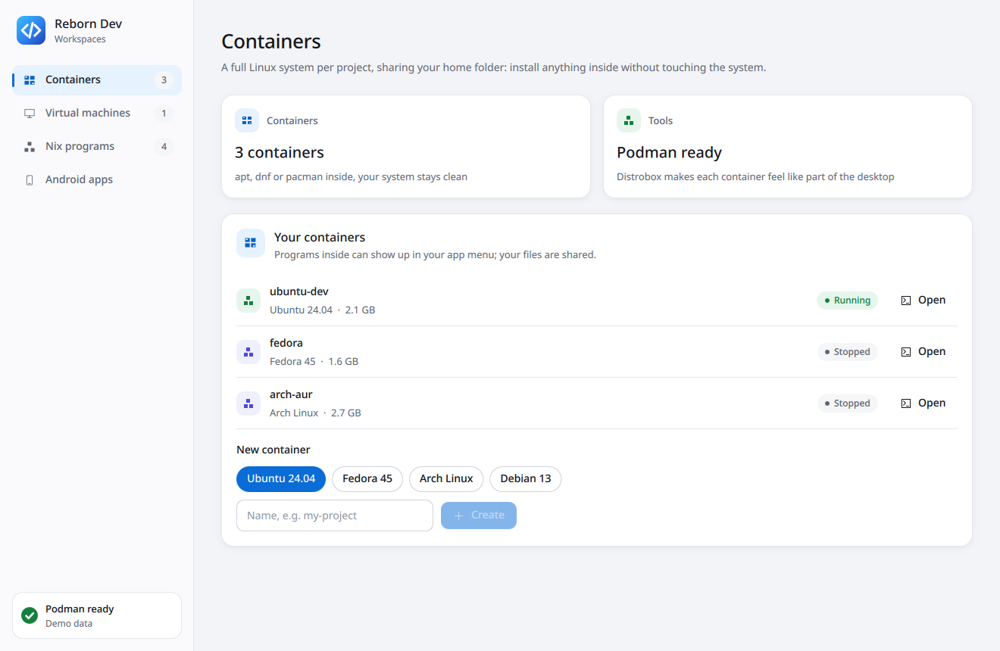
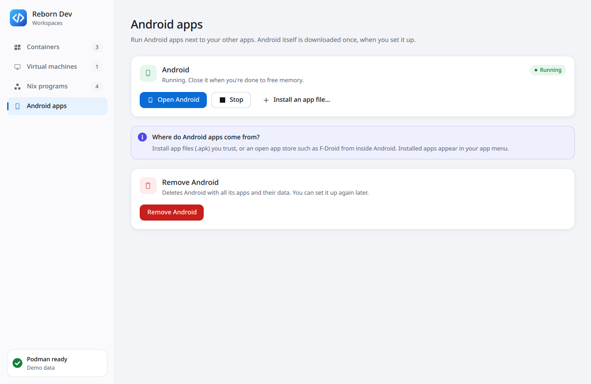
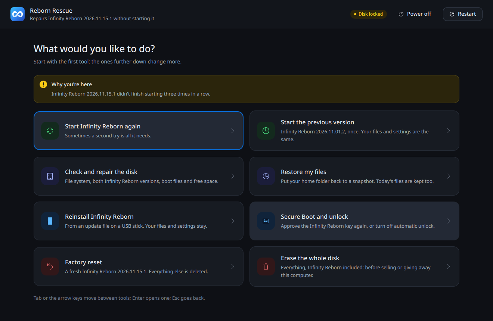
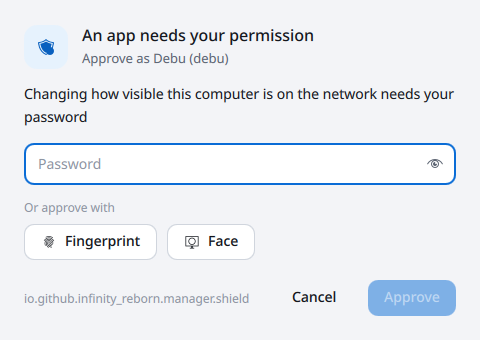
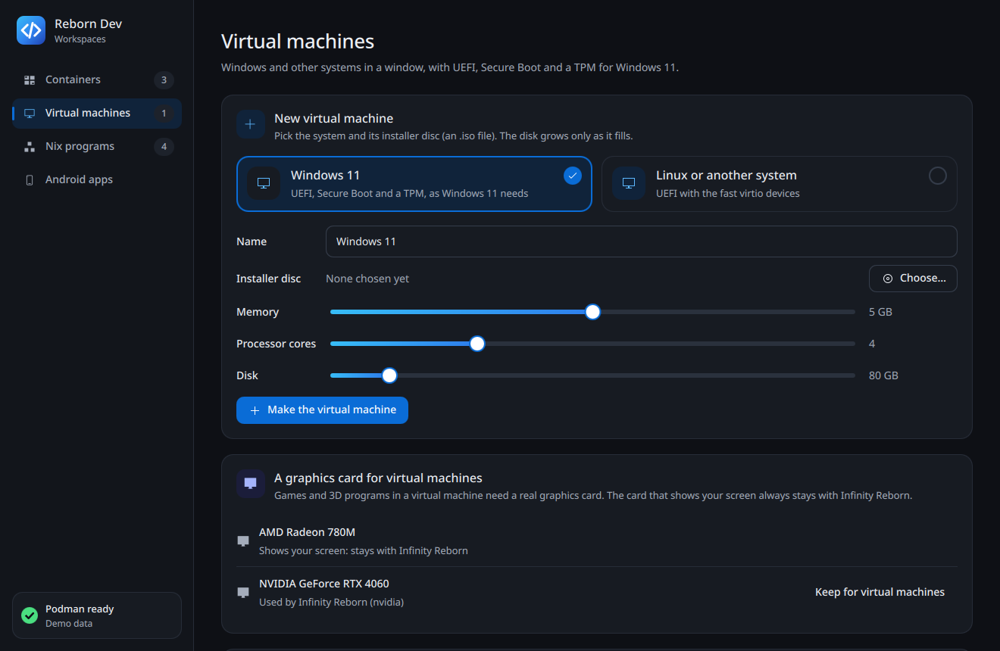

# Asima OS

**Asima OS Linux** is an image-based operating system for **development, gaming and everyday use**,
built to be installed once and keep working: every update is a complete, verified system, and a
version that doesn't start goes back to the one before it by itself.

> **In testing.** Asima OS is tested in virtual machines and on real PCs before its first public
> release. Don't trust it with anything important yet.

| | |
| --- | --- |
| **Status** | In testing, before the first public release ([what works today](docs/status.md), [changes](CHANGELOG.md)) |
| **Base** | Pinned Arch Linux snapshot 2026/11/14: systemd 262.2, Arch `linux` 7.3.4, KDE Plasma 6.8, KDE Gear 26.08 |
| **Hardware** | x86_64 PCs with UEFI; laptops, desktops and handhelds; AMD, Intel and NVIDIA graphics |
| **Desktop** | KDE Plasma 6.8 (Wayland) with KDE's standard look and a standard set of KDE apps |
| **System** | Read-only `/usr` (EROFS + dm-verity), two versions in the start menu, encrypted Btrfs pool |
| **Updates** | One signed file with the whole OS (`.aosupd`) |

## Highlights

- **Never breaks.** The OS is one verified, read-only image. The start menu keeps the current
  version and the one before it, for example **"Asima OS 2026.11.18.1 (current)"**; a new version
  that fails to start three times goes back to the backup by itself.
- **Install once.** OS versions are files inside the disk's pool, not fixed partitions, so the
  system can grow without repartitioning. Your files, settings, apps, containers and virtual
  machines live apart from the OS; updates and going back never touch them.
- **Updates are a file.** One signed `.aosupd` file carries the whole OS. It is checked before
  anything is written, picks up where it stopped after an interruption (even a power cut), and
  any version can jump straight to the newest.
- **Secure Boot and TPM.** Microsoft's shim (signed with both the 2011 and the 2023 certificate)
  and the build's own key, approved once; from then on the kernel is locked down, with the NVIDIA
  drivers signed. The TPM unlocks the disk only for genuine Asima OS boot images.
- **Repair without reinstalling.** Asima Rescue starts from the start menu and runs in RAM;
  "Repair this computer" on the USB stick rebuilds the start menu and the boot images.
- **Your data is safe.** Snapshots of your files and settings (daily, weekly or monthly), encrypted
  backups with automatic restore tests, a recovery key made at install, and a disk guard that asks
  before any tool wipes the Asima OS disk.
- **Every kind of app.** Flathub (with Discover), Snap, AppImage, Android apps (Waydroid), Nix and
  containers with Distrobox. Only what must run natively is in the system itself.
- **Ready for developers and gamers.** Podman, Distrobox and virtual machines, Nix, NTSYNC,
  controller and handheld support, switched on for everyone.
- **Asima OS apps, one job each.** Asima Updater, Asima Maintenance, Asima Manager, Asima Gaming
  and Asima Dev, plus the installer and Asima Rescue: Qt 6 apps, each with its own Rust system
  service. The `asimaos` command does the same jobs in a terminal.
- **Plain KDE.** The desktop is KDE Plasma with its standard look, everything you can change in
  System Settings included. Asima OS's own design is only where nothing needs changing: the
  start-up screen, which asks for the disk passphrase in your keyboard layout, and the Asima apps.
- **Your finger or face, when you choose.** The Asima OS password dialog approves admin tasks with a
  fingerprint or a face when you tap its button; a normal webcam can unlock the screen once you
  switch it on.

## Screenshots

| | |
| --- | --- |
|  |  |
|  |  |
|  |  |
|  |  |
|  |  |

Every screen, in light and dark: `apps/build.sh screenshots`.

## Build and try it

Needs Linux with rootless Podman, QEMU with OVMF and KVM; no sudo. Details:
[docs/building.md](docs/building.md).

```bash
apps/build.sh dist                 # the Asima OS apps and system services
./build.sh                         # the OS: image, disk image, live ISO, update file → build/out
python3 testbed/boot-test.py --iso   # install from the ISO in QEMU and check the installed system
testbed/run-qemu.sh build/out/asimaos-*-x86_64.iso   # try it yourself
```

Each build makes its own signing keys in `build/keys` (updates and Secure Boot). A PC installed
from that build accepts updates only from it, so keep the folder safe, backed up and out of every
repository.

## Repository layout

```text
├── build.sh       builds the OS in a rootless Arch container (stages in builder/stages)
├── builder/       the OS image: asimaos.conf (version, snapshot pin, packages, TEST-ONLY
│                  passwords), the build container, stages 10–80, rootfs/ (files added to the
│                  image: early mount, health checks, reset, the asimaos command, disk guard,
│                  game mode), repart.d/ (the disk layout)
├── engines/       the starters asimaos-install (the installer), asimaos-repair (USB stick) and
│                  asimaos-rescue-engine (Rescue), which run services/asimaos-engine
├── services/      Rust system services, one per app (updaterd, maintenanced, managerd, gamingd,
│                  faced), asimaos-svc (shared), asimaos-update (the .aosupd format and aosupd),
│                  asimaos-engine (installing, repairing and Rescue in one program), a PAM module,
│                  D-Bus / systemd / polkit / udev files
├── apps/          the Asima OS apps (Qt 6 + QML), each in its folder; ui/ (Asima UI, the design
│                  system), i18n/, DESIGN.md
├── testbed/       boot-test.py (QEMU: disk, Secure Boot, TPM, installs, updates, power cuts,
│                  Rescue, repair, reset), run-qemu.sh, services/ (end-to-end tests)
├── docs/          the documentation (below), guides/ and screenshots/
└── build/         build output, caches and the build's keys (git-ignored)
```

## Documentation

| Document | Contents |
| --- | --- |
| [Goals and decisions](docs/decisions.md) | The project's goals and decisions. **Wins** wherever documents disagree |
| [Architecture](docs/architecture.md) | How it works: layers, disk and subvolumes, early boot, boot chain, keys, updates and going back, reset, Rescue, what goes into `/usr`, self-maintenance, hardware |
| [Asima OS apps](apps/DESIGN.md) | Every app: its job, its screens, its service's contract, and the Asima UI design system |
| [What works today](docs/status.md) | Each capability and test with its result, and the limits by design |
| [Building and testing](docs/building.md) | Requirements, keys, stages, tests, trying it in a VM |
| [Roadmap](docs/roadmap.md) | What comes next, open questions and planned parts |
| [Guides](docs/guides/README.md) | For people who use it: installing, the key approval, the recovery key, updates, Rescue, testing updates |
| [Changelog](CHANGELOG.md) | What each version changed |
| [Contributing](CONTRIBUTING.md) | How to build, test and send changes |

## Related

- [Asima Hub](https://github.com/asimaos/asimaos-hub): the online app (news, downloads, the USB stick,
  updates); a Flatpak, never part of the system.
- [The website](https://asimaos.pages.dev/) ([source](https://github.com/asimaos/asimaos-website)): guides,
  downloads and news.

## License

[GPL-3.0-or-later](LICENSE).
